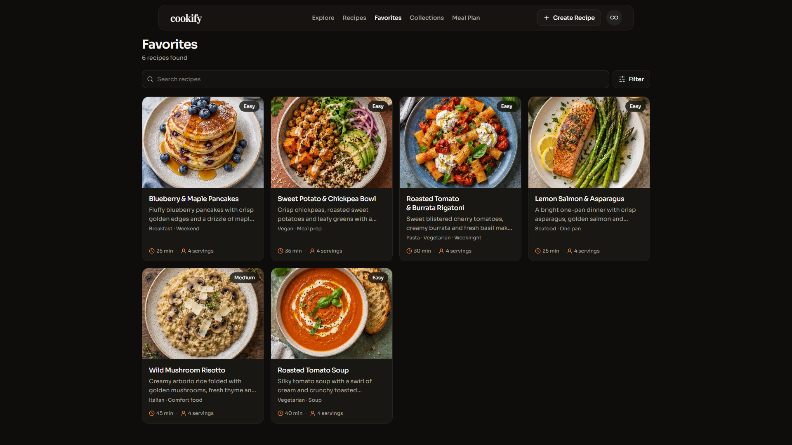
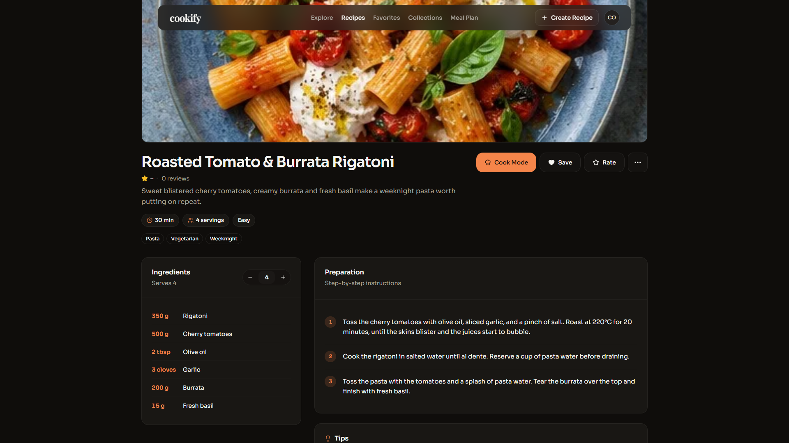
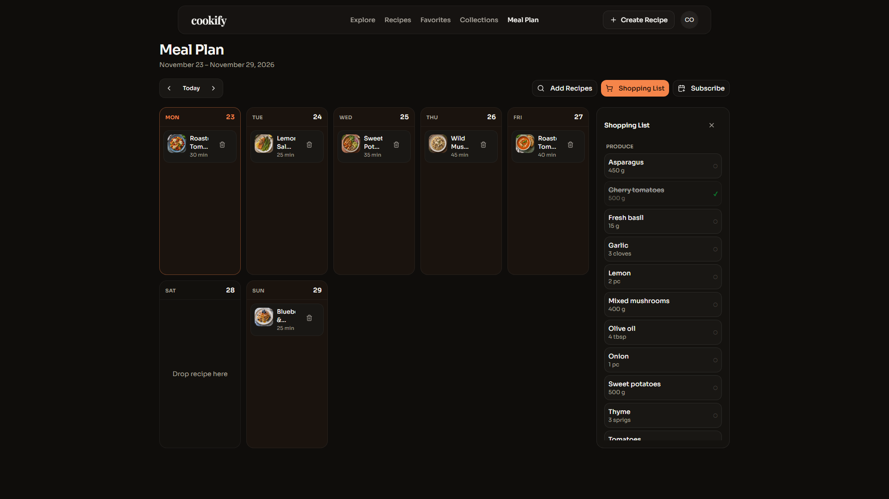
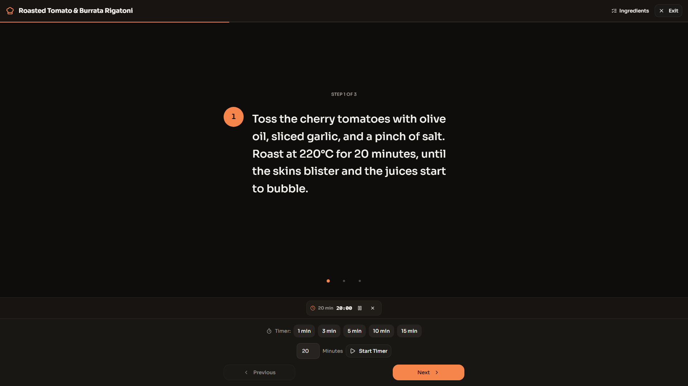

<div style="text-align: center;">

# Cookify - Your Personal Recipe App

**Discover, save, and organize all your favorite recipes in one place.**
Upload photos, rate dishes, build collections, and find inspiration in your own digital cookbook.

</div>

## Screenshots



<details>
<summary>Recipe details, weekly meal plan, and Cook Mode</summary>

### Recipe details



### Weekly meal plan



### Cook Mode



</details>

## Features

- **User Accounts**
    - Create your own account with login, registration, and profile settings.
    - Add and manage passkeys in Settings for passwordless sign-in.
    - Choose your preferred language and update your avatar.
- **Recipe Management**
    - Add, edit, and delete recipes with ingredients, steps, servings, cook time, difficulty, tags, tips, and optional nutrition per serving.
    - Change the serving count on a recipe to scale its ingredient quantities.
    - Upload a cover photo or paste an image URL to preview and save it. Cookify generates responsive WebP variants for saved recipe images.
    - Set recipes as **public** or **private** to control who can find and open them in Cookify.
- **Import from URL (Recipe Scraper)**
    - Paste a recipe page URL to import its title, ingredients, steps, and image when available in JSON-LD structured data.
    - When the structured recipe is missing or incomplete, Cookify can try to extract it with AI if configured and enabled.
- **AI Recipes (optional)**
    - Create recipes from a text idea or a photo (cookbook page, handwritten note, finished dish, or fridge contents).
    - Edit existing recipes with natural language (e.g. "make it vegan" or "for 8 servings").
    - AI-generated recipes include estimated nutrition per serving; nutrition can also be estimated for existing recipes.
    - Admins can enable or disable AI features globally at any time.
- **Smart Search & Filters**
    - Search by keyword and filter by difficulty, cook time, or tag. Limit results to your own recipes or click a recipe tag to browse matching dishes.
    - Powered by PostgreSQL full-text search, with fuzzy matching for typos.
- **Favorites & Ratings**
    - Mark recipes as favorites and rate them on a 1-5 scale.
- **Personal Cookbook Export**
    - Download your own recipes as a printable PDF cookbook or as a ZIP with recipe data, collection information, and locally stored cover photos.
- **Personal Collections**
    - Group recipes into custom collections for easy organization.
- **Weekly Meal Plan**
    - Plan meals by dragging recipes onto the weekly calendar or by selecting a recipe and then a day.
    - Auto-generated **shopping list** based on the recipes scheduled for the week, grouped by supermarket category. Items and checkmarks are saved per week.
    - **Calendar subscription (ICS)** lets you follow your meal plan in a calendar app. Anyone with the subscription URL can read the feed, including titles of private recipes on the plan. Keep the URL private and regenerate it if exposed. Hosted calendar services need a URL they can reach.
- **Installable PWA**
    - Install Cookify on your device. The service worker caches recently loaded pages and images for limited offline access. Sign-in, edits, and features that fetch live data require a connection.
- **Cook Mode**
    - Follow recipes step by step and open the ingredient list as you cook. Cookify keeps the screen awake on supported browsers.
    - Run multiple countdowns at once with preset or custom timers. Cookify also offers a timer when it recognizes a duration in the current step.
- **Recipe Sharing**
    - Owners can create a share link for either a public or a private recipe. Anyone with the active link can view the recipe without an account. Revoke the link separately to end access through it.
    - Track view counts to see how often your recipes have been viewed.
- **Home Dashboard**
    - A personal **For you** feed learns from favorites, ratings and cooking history.
    - Browse popular recipes, recently added dishes, and discover something new through curated carousels.
    - Find similar dishes on recipe detail pages.
- **Administration & Backup**
    - Admin panel to manage users and toggle new registrations on/off.
    - Export app data and uploaded files as a ZIP. Store and transfer backup archives securely because they include password hashes and calendar subscription tokens. Avoid restoring from this branch with the supplied Docker Compose setup. Restoration can replace database records and remove uploaded files before failing on the uploads mount.
- **Multilingual Support**
    - Available in **English**, **German**, and **Spanish**.

## Installation

### Using Docker

1. Create a `.env` file for Docker Compose, for example:

    ```dotenv
    # App
    NODE_ENV=production
    ORIGIN=http://localhost:3000
    DATABASE_URL=postgres://cookify:secret@db:5432/cookify

    # Postgres DB
    POSTGRES_USER=cookify
    POSTGRES_PASSWORD=secret
    POSTGRES_DB=cookify
    ```

    Replace `secret` with the same URL-safe password in both database settings.

2. Create a `docker-compose.override.yml` to publish the app on your local machine:

    ```yaml
    services:
      app:
        ports:
          - "127.0.0.1:3000:3000"
    ```

3. Run `docker compose up -d --build` and open `http://localhost:3000`. The first account you register becomes the administrator.

### Configuration Notes

* File uploads are persisted in the `./uploads` directory (mounted into the container).

* **AI configuration (optional):**
  The AI features use an OpenAI-compatible chat completions endpoint. They become available once a key is configured unless an administrator has disabled AI. Leave the key unset to keep AI unavailable.
  Add these variables to your `.env` / Coolify environment:

  ```dotenv
  OPENAI_KEY=your_api_key
  OPENAI_BASE_URL=https://ollama.com/v1
  OPENAI_MODEL=deepseek-v4.1-flash:1017          # text model
  OPENAI_VISION_MODEL=deepseek-v4.1-flash:1017   # used for image input
  ```

  This example uses Ollama Cloud. For another provider, set its base URL and both model IDs to values supported by that provider. Administrators can turn AI on or off under **Administration → AI**.
  AI requests send relevant recipe text, photos, or imported page content to the configured provider. Review its privacy policy before enabling AI.

* Database **migrations** run automatically on container start (`scripts/migrate.ts`).

* **Coolify deployment** uses `docker-compose.yml`. Route your public HTTPS domain to the `app` service on port `3000` and set `ORIGIN` to that public URL. HTTPS is required for passkeys and PWA features on a remote deployment. On a fresh instance, registration is open by default and the first account becomes administrator. Restrict access until you have registered that account.
* **Default language:** Set `DEFAULT_LOCALE=de` in the runtime environment (supported: `en`, `de`, `es`; fallback: `en`). Profile language takes priority, followed by a saved language cookie. New visitors and newly registered accounts use the default. Existing account preferences are preserved. Redeploy after changing the environment variable.
